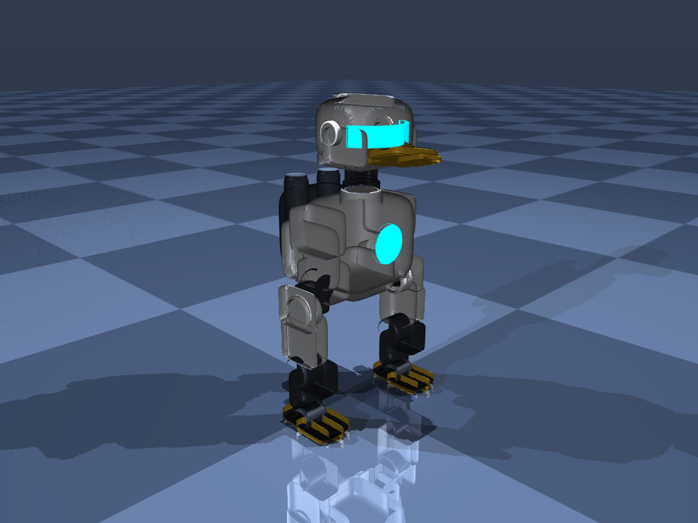
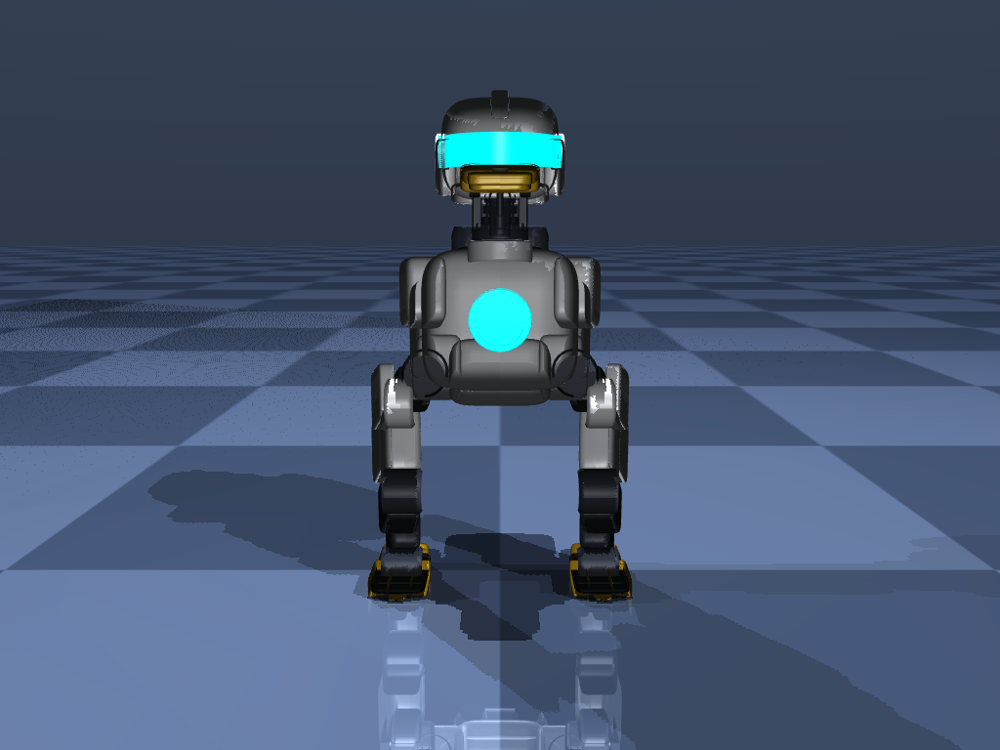

# MicroDuck 8-DOF / CyberDuck V2

An 8-DOF bipedal robot platform powered by metal-gear MG996R servos for sim-to-real reinforcement learning. Designed with a decoupled real-time inference architecture supporting three standalone embedded hardware tiers: Raspberry Pi 5, Raspberry Pi Zero 2 W, and Dual ESP32-S3.

[](https://hub.xerj.org/contributors/PhelanDev)
[](LICENSE)
[](https://www.python.org/)
[](https://mujoco.org/)

> **XERJ Corpus Hub Selected Contribution**  
> MicroDuck's decoupled real-time inference runtime on Raspberry Pi Zero 2 W was selected by [XERJ Corpus Hub](https://hub.xerj.org/contributors/PhelanDev) as an open reference memory solution for autonomous AI coding agents:  
> *"We came across your 'feat(pizero2w): add decoupled real-time inference runtime for Pi Zero 2 W with tests' in PhelanDev/DUCK_MINI_TRAINING and think it could help others. It is a substantial piece of work, with 6 files and about 460 lines across pipelines and tests, in Python, with the tests landing in the same commit."*  
> — **Ivan**, Founder of XERJ ([github.com/xerj-org/xerj](https://github.com/xerj-org/xerj))

<p align="center">
  
  
</p>

---

## 1. Hardware Stacks

MicroDuck maintains three independent hardware targets under `pipelines/`. Each pipeline has dedicated MJCF and URDF models, physics parameters, and deployment runtimes:

| Parameter | Raspberry Pi 5 | Dual ESP32-S3 | Raspberry Pi Zero 2 W |
| :--- | :--- | :--- | :--- |
| **Pipeline path** | `pipelines/rpi5_stack/` | `pipelines/dual_esp32s3_stack/` | `pipelines/pizero2w_stack/` |
| **Total mass** | 764 g | 684 g | 649 g |
| **Main compute** | Broadcom BCM2712 Quad A76 @ 2.4 GHz | 2× ESP32-S3 Dual LX7 @ 240 MHz | Broadcom BCM2710A1 Quad A53 @ 1.0 GHz |
| **Memory** | 4 GB / 8 GB LPDDR4X | 2× 512 KB SRAM + 8 MB PSRAM | 512 MB LPDDR2 |
| **Operating system** | Raspberry Pi OS 64-bit | FreeRTOS (bare metal) | Raspberry Pi OS Lite 64-bit |
| **Servo interface** | PCA9685 I2C PWM driver | 8-channel hardware LEDC PWM | PCA9685 I2C PWM driver |
| **Policy runtime** | Float32 ONNX Runtime (50 Hz) | Quantized INT8 ESP-NN C++ (50 Hz) | Float32 ONNX Runtime (50 Hz) |
| **Inter-chip bus** | Internal system bus | High-speed UART2 @ 921,600 baud with CRC16 | Internal system bus |
| **Primary focus** | Onboard vision & dense models | Low-power embedded execution | Lightweight headless Linux runner |

---

## 2. CyberDuck V2 Pro: Athletic Redesign

CyberDuck V2 Pro redesigns the bipedal chassis with high-definition bionic styling and improved mechanical balance:

- **17 Precision CAD Parts**: High-density STL meshes (>125,000 triangles total) comprising an aero helmet, cyan visor, metallic beak, filleted neck collar, chest plate, rear thruster pack, leg linkages, and 3-claw athletic feet.
- **Universal Gimbal Neck**: Dual-DOF universal joint matching hip gimbal mechanics. Head is lowered by 8 mm into an aggressive athletic stance, with a filleted collar eliminating visual gaps.
- **Athletic Soles**: Ground contact footprint measured at $50\text{ mm} \times 26\text{ mm} \times 10\text{ mm}$ with a flat, coplanar contact plane at $Z = 0.000\text{ m}$ and high-traction rubber tread geoms.
- **CAD Exports**: Full 3D assembly in `duck_v2/cad/cyberduck_v2_assembly.obj` with MTL PBR materials, accompanied by printable parts in `duck_v2/cad/cyberduck_v2_stl_parts.zip`.
- **Integrated Sensor Suite**: Base 6-DOF IMU, dual foot touch sensors, 8-joint encoders, and an onboard head camera, directly compatible with 37-dim and 42-dim PPO observation spaces.

---

## 3. Kinematics & Servo Specifications

All joints are actuated by metal-gear MG996R servos (stall torque 1.0 N·m, maximum speed 6.0 rad/s).

### Chibi Squat Geometry

The chassis employs a short-leg layout ($1 : 0.9 : 1$ head-to-torso-to-leg ratio) to maintain low center of mass:

- Thigh length ($L_1$): 32 mm (mass 40 g).
- Shin length ($L_2$): 32 mm (mass 30 g).
- Foot dimensions: 50 × 26 × 10 mm (mass 22 g).
- Inner foot clearance: 28 mm to 58 mm, avoiding self-collisions during lateral sway.
- Base link origin: $Z = 0.095\text{ m}$.
- Low roll overturning torque during single-support phases ($< 0.35\text{ N}\cdot\text{m}$) remains well within servo thermal margins.

### Joint Limits

| Joint Name | Axis | Limits (rad) | Limits (deg) | Rated Torque | Max Speed |
| :--- | :---: | :---: | :---: | :---: | :---: |
| `head_yaw` | $Z$ | $[-1.57, +1.57]$ | $\pm 90^\circ$ | 1.0 N·m | 6.0 rad/s |
| `head_pitch` | $Y$ | $[-0.52, +0.78]$ | $-30^\circ \to +45^\circ$ | 1.0 N·m | 6.0 rad/s |
| `left_hip_roll` | $X$ | $[-0.44, +0.44]$ | $\pm 25^\circ$ | 1.0 N·m | 6.0 rad/s |
| `left_hip_pitch` | $Y$ | $[-0.87, +0.87]$ | $\pm 50^\circ$ | 1.0 N·m | 6.0 rad/s |
| `left_knee_pitch` | $Y$ | $[0.00, +1.48]$ | $0^\circ \to +85^\circ$ | 1.0 N·m | 6.0 rad/s |
| `right_hip_roll` | $X$ | $[-0.44, +0.44]$ | $\pm 25^\circ$ | 1.0 N·m | 6.0 rad/s |
| `right_hip_pitch` | $Y$ | $[-0.87, +0.87]$ | $\pm 50^\circ$ | 1.0 N·m | 6.0 rad/s |
| `right_knee_pitch` | $Y$ | $[0.00, +1.48]$ | $0^\circ \to +85^\circ$ | 1.0 N·m | 6.0 rad/s |

---

## 4. Behavioral Engine & AI Vision

### Kinematic Gaits and Reflexes

Located in `training/advanced_gaits.py`:

- **Waddling Gait**: Bionic locomotion with rhythmic pelvic roll sway (0.09 rad) and double-frequency head nodding.
- **Spot Turn**: 360-degree rotation in place ($v_x = 0, \omega_z \ne 0$) without forward translation.
- **Head Dance**: Expressive Lissajous head gestures while maintaining a stable stance.
- **Fall Recovery**: 3-phase finite state machine (`ORIENT_PRONE` $\to$ `CROUCH_TO_SIT` $\to$ `PUSH_TO_STAND`) with angular rate limits ($|\Delta q| \le 0.10\text{ rad/step}$) to protect servo gears.

### AI Vision and Visual Servoing

Located in `training/vision_tracker.py`:

- **Color Blob Tracking**: High-throughput HSV segmentation for yellow targets and red objects running at 30+ FPS.
- **Visual Servoing**: Closed-loop proportional tracking for `head_yaw` and `head_pitch` with an anti-jitter deadband (0.06) and slew rate limiting.
- **Embedded C++ Loop**: Sub-sampled RGB565 scan routine in `pipelines/dual_esp32s3_stack/deployment/mcu1_vision_audio_s3/mcu1_main.ino` streaming 8-byte binary UART servo packets to MCU 2.

---

## 5. Unified CLI: duck.py

The root `duck.py` CLI provides a single command surface across development workflows:

```bash
# Check system status, checkpoints, and hardware targets
python duck.py status

# Verify kinematics consistency between MJCF and URDF
python duck.py verify

# Launch interactive 3D simulation
python duck.py view

# View CyberDuck V2 Pro
python duck.py view --v2

# Run waddling gait demonstration
python duck.py view --gait waddle

# Run spot turn demonstration
python duck.py view --gait spot_turn

# Enable visual servoing with onboard head camera
python duck.py view --track --target-color yellow

# Combine CyberDuck V2 with waddling gait and vision tracking
python duck.py view --v2 --gait waddle --track

# Train PPO policy for target platform
python duck.py train --target rpi5 --envs 256 --iterations 500
python duck.py train --target pizero2w --envs 256 --iterations 500
python duck.py train --target esp32 --envs 256 --iterations 500
python duck.py train --target v2 --envs 256 --iterations 500

# Export trained policy
python duck.py export --target rpi5
python duck.py export --target pizero2w
python duck.py export --target esp32
```

---

## 6. Repository Layout

```text
duckV1/
├── duck.py                                   # Unified operations CLI
├── README.md                                 # Technical documentation
├── LICENSE                                   # MIT License
├── .gitignore                                # Git ignore configuration
├── duck_v2/                                  # CyberDuck V2 Pro
│   ├── cyberduck_v2.xml                      # MuJoCo MJCF model with full sensor suite
│   ├── cad/                                  # 3D CAD Assembly OBJ, MTL & STL Zip
│   ├── meshes/                               # 17 high-definition STL meshes
│   └── media/                                # High-res renders (ISO, front, exploded)
├── models/                                   # Base physical models
│   ├── mjcf/microduck_8dof.xml               # Base MuJoCo XML model
│   ├── urdf/microduck_8dof.urdf              # Base URDF model
│   ├── microduck_pizero2w_policy.onnx        # Exported ONNX policy for Pi Zero 2 W
│   └── checkpoints/microduck_ppo.pt          # PyTorch training checkpoint
├── pipelines/                                # Hardware targets
│   ├── rpi5_stack/                           # Raspberry Pi 5 target
│   ├── dual_esp32s3_stack/                   # Dual ESP32-S3 target
│   └── pizero2w_stack/                       # Raspberry Pi Zero 2 W target (XERJ corpus)
├── scripts/                                  # Development utilities
│   ├── verify_model.py                       # Physical model consistency verification
│   ├── interactive_viewer.py                 # Interactive 3D visualizer and simulator
│   ├── export_policy.py                      # Policy export (ONNX or INT8 C++ Header)
│   └── train_ppo.py                          # Multi-environment PPO training script
├── training/                                 # Simulation & perception core
│   ├── advanced_gaits.py                     # Waddle, spot turn, head dance & fall recovery
│   ├── vision_tracker.py                     # AI vision color blob tracker & visual servoing
│   ├── self_righting.py                      # 3-Phase reflex recovery finite state machine
│   ├── env_config.py                         # Observation space and reward function
│   └── run_parallel_sim.py                   # Parallel multi-environment simulation
└── docs/                                     # Architecture documentation
    └── specs/                                # Engineering specifications
```

---

## 7. License

Distributed under the [MIT License](LICENSE). Copyright (c) 2026 PhelanDev.
